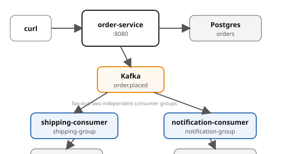

# Example 05 — Event-Driven Architecture

Demonstrates **event-driven fan-out** with Kafka: the order-service publishes
`order.placed` events, and two independent consumer groups (shipping, notification)
each react to the same stream — with **idempotent deduplication** via database
UNIQUE constraints.

## Prerequisites

- [Docker Engine](https://docs.docker.com/engine/install/) with the Compose plugin, on
  Fedora or RHEL (see [Prerequisites](../PREREQUISITES.md))
- `curl` and `jq` for driving the API
- ~3 GB free memory (LGTM + Postgres + Kafka + 3 app services)

See the [shared infrastructure README](../_infra/README.md) for ports,
credentials, and the container naming convention.

## What it shows

| Pattern | Where | What |
|---------|-------|------|
| Event production | `POST /orders` | Order written to DB, `order.placed` published to Kafka |
| Fan-out (two consumer groups) | shipping + notification | Both consume the same topic independently |
| Commit-after-side-effect | consumers | DB insert happens first; Kafka offset committed only after success |
| Idempotent consumers | UNIQUE constraint | Duplicate events are silently skipped (no double shipment/notification) |

## Architecture



## Run it

Pick a language and start the stack:

```bash
# Python (FastAPI)
cd python && docker compose up -d --build --wait

# Spring Boot
cd spring-boot && docker compose up -d --build --wait
```

Both implementations expose the same API on the same ports — `verify.sh` works with either.

Wait for all services:

```bash
docker compose ps
```

## Drive it

```bash
# Place an order
curl -s -X POST -H 'Content-Type: application/json' \
  -d '{"sku":"widget-a","quantity":5}' \
  localhost:8080/orders | jq .

# List orders
curl -s localhost:8080/orders | jq .

# Check that both consumers processed
docker exec cndp-postgres psql -U appuser -d appdb \
  -c "SELECT * FROM shipments;"
docker exec cndp-postgres psql -U appuser -d appdb \
  -c "SELECT * FROM notifications;"

# Verify consumer groups
docker exec cndp-kafka /opt/kafka/bin/kafka-consumer-groups.sh \
  --bootstrap-server localhost:9092 --list
```

## Run on minikube

The same services and the same `verify.sh` run on a single-node minikube cluster (Docker
driver, Kubernetes v1.36.5) with Kafka managed by the Strimzi operator. See
[`k8s/README.md`](k8s/README.md) for the commands and Appendix R in the site for the design.

```bash
k8s/setup-profile.sh && k8s/build-images.sh go && k8s/deploy.sh go
RUNTIME=kubernetes BASE=http://127.0.0.1:30080 ./verify.sh
```

## Run on OpenShift Local

The same services (Spring Boot, Quarkus, .NET, Python and Go) and the same `verify.sh` run on
OpenShift Local with AMQ Streams for Kafka, the Red Hat Postgres image, pods under the
`restricted-v2` SCC and edge-TLS Routes. See [`openshift/README.md`](openshift/README.md) for the
commands and Appendix S in the site for the design. It needs CRC sized 12 vCPU and 32768 MiB, and it
refuses to start while minikube or any container is running.

```bash
openshift/setup-crc.sh && openshift/build-push-images.sh go && openshift/deploy.sh go
RUNTIME=kubernetes KUBECTL=oc KUBE_CONTEXT=crc-admin BASE=https://order-service-cndp-05.apps-crc.testing \
  CURL_OPTS="--cacert $HOME/.local/state/cndp-05-crc/ingress-ca.crt" ./verify.sh
openshift/teardown.sh
```

## Verify

From the example root (not the language directory):

```bash
cd ..  # if you're in a language directory
./verify.sh
```

## Observe

Open Grafana at http://localhost:3000:

- **Tempo** — traces from order-service, shipping-consumer, notification-consumer (the trace context travels in the Kafka record headers, so one trace spans the producer and both consumers)
- **Loki** — search for `order.placed` to see the event flow across services

## Ports

| Service | Port |
|---------|------|
| order-service | 8080 |
| Grafana | 3000 |
| Postgres | 5432 |
| Kafka (host) | 9092 |
| OTLP HTTP | 4318 |
