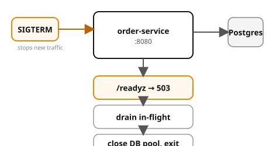

# Example 21 — Graceful Shutdown

Demonstrates the **Kubernetes-aware graceful shutdown protocol**: on SIGTERM,
the service flips readiness to 503 (so the load balancer stops sending new
traffic), keeps serving for a short drain delay while endpoints update, stops accepting
connections, finishes in-flight requests, closes resources and exits 0. Kubernetes sends one
SIGTERM and follows with SIGKILL when `terminationGracePeriodSeconds` runs out, so the whole
sequence starts on that single signal and fits inside the grace period.

## Prerequisites

- [Docker Engine](https://docs.docker.com/engine/install/) with the Compose plugin, on
  Fedora or RHEL (see [Prerequisites](../PREREQUISITES.md))
- `curl` and `jq` for driving the API
- ~1 GB free memory (Postgres + 1 app service)

See the [shared infrastructure README](../_infra/README.md) for ports,
credentials, and the container naming convention.

## What it shows

| Pattern | Where | What |
|---------|-------|------|
| SIGTERM handler | signal handler | One signal starts the drain: sets the `shutting_down` flag |
| Readiness flip | `/readyz` | Returns 503 when shutting down; `/healthz` stays 200 |
| Drain delay | `DRAIN_DELAY_SECONDS` (default 5) | Keeps serving while endpoint removal propagates (the preStop sleep) |
| In-flight drain | shutdown hook | Stops accepting, finishes in-flight requests (20 s bound), closes the pool, exits 0 |
| Data survives restart | verify.sh | Orders placed before restart are still queryable after |

## Architecture



## Run it

Pick a language and start the stack:

```bash
# Python (FastAPI)
cd python && docker compose up -d --build --wait

# Spring Boot
cd spring-boot && docker compose up -d --build --wait
```

Both implementations expose the same API on the same ports — `verify.sh` works with either.

## Drive it

```bash
# Verify service is ready
curl -s localhost:8080/readyz | jq .

# Place an order
curl -s -X POST -H 'Content-Type: application/json' \
  -d '{"sku":"widget","quantity":1}' \
  localhost:8080/orders | jq .

# Send one SIGTERM (what the kubelet sends)
docker kill --signal SIGTERM cndp-order-service

# Readiness flips at once; the service keeps serving for DRAIN_DELAY_SECONDS, then exits 0
curl -s localhost:8080/readyz | jq .
docker wait cndp-order-service

# Check internal state
curl -s localhost:8080/debug/state | jq .
```

## Verify

From the example root (not the language directory):

```bash
cd ..  # if you're in a language directory
./verify.sh
```

`verify.sh` sends the single SIGTERM, checks the 503 flip while the service is still up,
waits for the container to exit by itself with code 0 inside the 30 s grace period, restarts it,
and finishes with a `docker stop -t 30` timing check (exit 0, not 137).

## Ports

| Service | Port |
|---------|------|
| order-service | 8080 |
| Postgres | 5432 |
